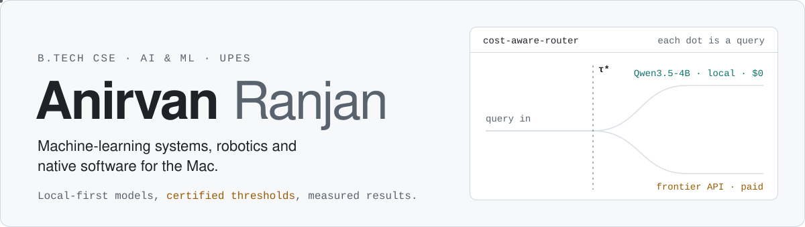
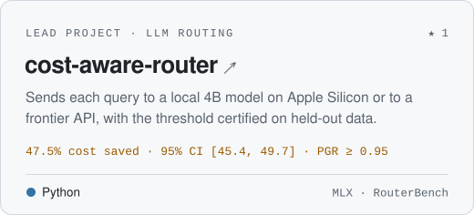
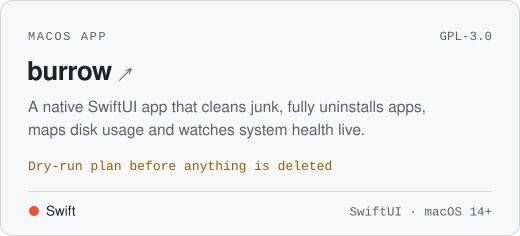
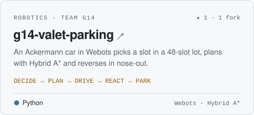
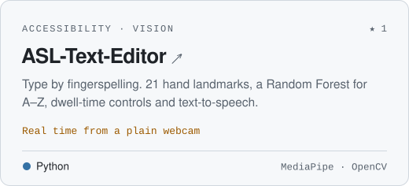

<picture>
  <source media="(prefers-color-scheme: dark)" srcset="assets/header-dark.svg">
  
</picture>

 

I study computer science (AI & ML) at UPES. I build machine-learning systems that run on the machine in front of you and report their numbers with confidence bounds. I also work on robots that park themselves and native apps for macOS.

### Featured

  <a href="https://github.com/AnirvanRanjan/cost-aware-router"><picture><source media="(prefers-color-scheme: dark)" srcset="assets/card-router-dark.svg"></picture></a>
  <a href="https://github.com/AnirvanRanjan/burrow"><picture><source media="(prefers-color-scheme: dark)" srcset="assets/card-burrow-dark.svg"></picture></a>
  <a href="https://github.com/AnirvanRanjan/g14-valet-parking"><picture><source media="(prefers-color-scheme: dark)" srcset="assets/card-valet-dark.svg"></picture></a>
  <a href="https://github.com/AnirvanRanjan/ASL-Text-Editor"><picture><source media="(prefers-color-scheme: dark)" srcset="assets/card-asl-dark.svg"></picture></a>

### Now

- **cost-aware-router**: locking the Qwen3.5-4B vs GPT-4 results. The first preview keeps 95% of GPT-4's quality advantage at about 1.9× lower cost.
- **Semester VII**: Algorithms for Intelligent Systems and Robotics, and an NLP lab.

### Toolbox

`Python` `MLX` `scikit-learn` `MediaPipe` `OpenCV` &nbsp;·&nbsp; `Swift` `SwiftUI` &nbsp;·&nbsp; `Webots` `Hybrid A*` `Pure Pursuit` &nbsp;·&nbsp; `Lua` `Neovim` `Ollama`
